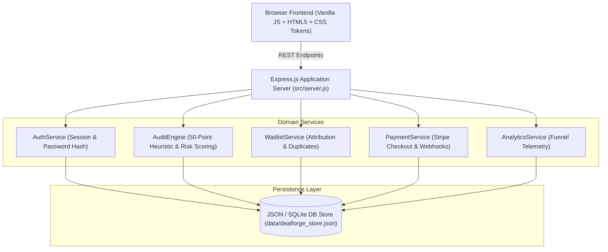

# Document 09: MVP Architecture, Data Schema & API Contract Specification

## 1. System Architecture & Component Diagram



---

## 2. Core User Stories & Acceptance Criteria

### US-1: Proposal Risk Audit Workflow
- **As an** agency owner or project director,
- **I want to** paste our draft Statement of Work into the scanner,
- **So that** I immediately see all hidden scope creep triggers, subjective acceptance phrases, and margin risk calculations.
- **Acceptance Criteria**:
  1. Scan finishes in <3.0 seconds.
  2. Generates an overall Risk Score between 0 and 100.
  3. Displays categorized vulnerabilities (Scope, Acceptance, Payment, Liability, Revisions).
  4. Provides drop-in protective amendment text for each flagged issue.

### US-2: Multi-Tenant Authentication & Session Isolation
- **As an** agency user,
- **I want to** register and securely sign in with email and password,
- **So that** my confidential proposal audit history is strictly inaccessible to other agencies.
- **Acceptance Criteria**:
  1. Password hashed using PBKDF2 with unique cryptographic salt.
  2. Signed session token (HMAC-SHA256).
  3. Strict server-side route guards: unauthorized requests to `/api/proposals` receive HTTP 401.

### US-3: Verified Test Checkout & Entitlement Provisioning
- **As an** agency buyer,
- **I want to** upgrade to the Pro plan or Lifetime license using Stripe test mode,
- **So that** my account plan updates automatically upon payment confirmation.
- **Acceptance Criteria**:
  1. Server creates Stripe Checkout session with immutable price IDs.
  2. Cryptographic signature check (`stripe-signature` header) on incoming webhook.
  3. Idempotent event processing to prevent duplicate account upgrades.

---

## 3. Relational Data Entities & Schemas

```sql
-- Users Entity
CREATE TABLE users (
  id TEXT PRIMARY KEY,
  email TEXT UNIQUE NOT NULL,
  name TEXT NOT NULL,
  agency_name TEXT,
  password_hash TEXT NOT NULL,
  salt TEXT NOT NULL,
  plan TEXT DEFAULT 'starter' CHECK(plan IN ('starter', 'pro', 'lifetime')),
  scans_used_this_month INTEGER DEFAULT 0,
  created_at TIMESTAMP DEFAULT CURRENT_TIMESTAMP
);

-- Proposals & Audits Entity
CREATE TABLE proposals (
  id TEXT PRIMARY KEY,
  user_id TEXT NOT NULL REFERENCES users(id),
  title TEXT NOT NULL,
  raw_text TEXT NOT NULL,
  risk_score INTEGER NOT NULL CHECK(risk_score BETWEEN 0 AND 100),
  risk_level TEXT CHECK(risk_level IN ('LOW', 'MODERATE', 'HIGH', 'CRITICAL')),
  estimated_margin_bleed_usd NUMERIC(10,2),
  flagged_clauses_json TEXT NOT NULL,
  created_at TIMESTAMP DEFAULT CURRENT_TIMESTAMP
);

-- Orders & Entitlements Entity
CREATE TABLE orders (
  id TEXT PRIMARY KEY,
  user_id TEXT NOT NULL REFERENCES users(id),
  plan TEXT NOT NULL,
  amount_cents INTEGER NOT NULL,
  currency TEXT DEFAULT 'usd',
  status TEXT DEFAULT 'pending' CHECK(status IN ('pending', 'completed', 'failed')),
  stripe_session_id TEXT UNIQUE,
  created_at TIMESTAMP DEFAULT CURRENT_TIMESTAMP
);

-- Waitlist Entity
CREATE TABLE waitlist (
  id TEXT PRIMARY KEY,
  email TEXT UNIQUE NOT NULL,
  position INTEGER NOT NULL,
  attribution_json TEXT,
  consent_given BOOLEAN NOT NULL DEFAULT 1,
  created_at TIMESTAMP DEFAULT CURRENT_TIMESTAMP
);
```

---

## 4. OpenAPI 3.1 Endpoint Contracts

### 1. Waitlist
- `POST /api/waitlist`
  - Body: `{ email: string, attribution?: object, consentGiven: boolean }`
  - Responses: `201 Created` (`{ success: true, position: 42 }`), `409 Conflict` (Duplicate email).

### 2. Authentication
- `POST /api/auth/register`
  - Body: `{ email: string, password: string, name: string, agencyName?: string }`
  - Responses: `201 Created` (`{ token, user }`), `409 Conflict`.
- `POST /api/auth/login`
  - Body: `{ email: string, password: string }`
  - Responses: `200 OK` (`{ token, user }`), `401 Unauthorized`.
- `GET /api/auth/me`
  - Headers: `Authorization: Bearer <token>`
  - Responses: `200 OK` (`{ user }`), `401 Unauthorized`.

### 3. Proposal Risk Scanner
- `POST /api/proposals/audit`
  - Headers: `Authorization: Bearer <token>` (or anonymous demo mode)
  - Body: `{ title: string, text: string, estimatedDealValue?: number }`
  - Responses: `200 OK` (`{ id, riskScore, riskLevel, estimatedBleed, flaggedCount, issues: [...] }`).
- `GET /api/proposals`
  - Headers: `Authorization: Bearer <token>`
  - Responses: `200 OK` (`{ proposals: [...] }`).

### 4. Stripe Checkout & Webhook
- `POST /api/checkout/create-session`
  - Body: `{ plan: 'pro' | 'lifetime', successUrl: string, cancelUrl: string }`
  - Responses: `200 OK` (`{ checkoutUrl: string, sessionId: string }`).
- `POST /api/webhooks/stripe`
  - Headers: `stripe-signature: <hmac_signature>`
  - Body: Raw Stripe event payload
  - Responses: `200 OK` (`{ received: true }`), `400 Bad Request` (Invalid signature).

---

## 5. Deliberate Scope Exclusions (Post-MVP Roadmap)
- Full e-signature execution workflow (Users continue using DocuSign/PandaDoc for final execution).
- Multi-party live Google Docs extension (MVP operates via high-speed web paste/upload).
- Complex custom enterprise SSO (SAML/Okta) deferred to Series Seed.
